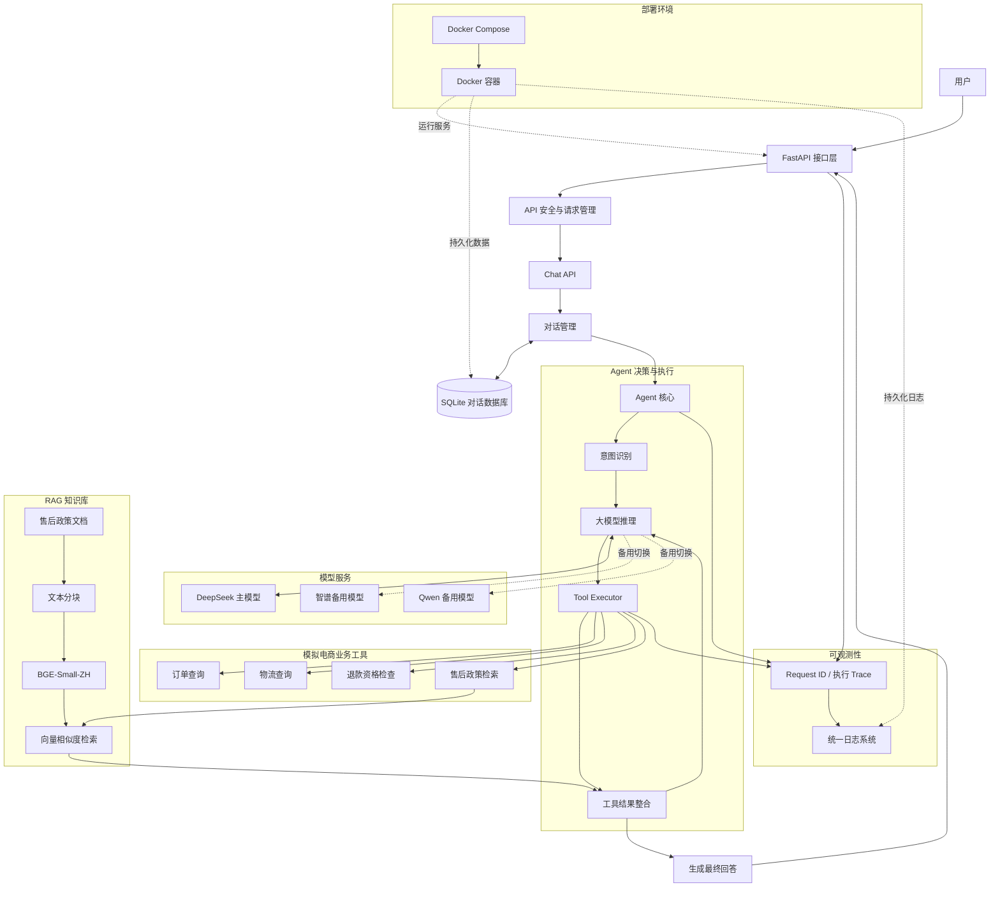

# ShopMate — 智能电商售后 Agent

ShopMate 是一个基于 Python、FastAPI 和大语言模型构建的智能电商售后助手。

项目通过 Agent、Function Calling、RAG 知识库检索等技术，实现订单查询、物流查询、退款资格检查、售后政策问答，以及**售后申请的生成与提交（带人工确认闸门）**。

项目重点在于探索大语言模型在实际业务场景中的应用，包括工具调用、知识库检索、多模型备用、对话持久化、请求追踪、**写操作的安全控制**和 Docker 部署。

## 一、项目功能

### 1. 智能 Agent

- 基于大语言模型理解用户意图。
- 支持多轮对话。
- 根据用户需求选择合适的业务工具。
- 通过 Function Calling / Tool Calling 执行业务操作。
- 整合工具执行结果，生成自然语言回答。

### 2. 电商售后业务工具

| 工具 | 功能 | 副作用 |
|---|---|---|
| get_order | 查询订单信息 | 无 |
| get_logistics | 查询物流信息 | 无 |
| check_refund_eligibility | 检查退款资格 | 无 |
| search_after_sales_policy | 检索售后政策 | 无 |
| draft_after_sales_ticket | 生成待确认的售后申请草稿 | 无（只写草稿表） |
| confirm_after_sales_ticket | 确认并正式创建工单 | **有（进人工审核队列）** |
| get_after_sales_tickets | 查工单进度，以及有没有没提交的草稿 | 无 |
| cancel_after_sales_ticket | 撤销已提交的售后申请 | **有（工单转「已撤销」）** |

### 3. 写操作的四道闸门

对话路径能改变系统状态，就必须回答一个问题：
**模型判断错了，会不会建出一张不该建的工单？**

工单背后是人工审核和退款流程，误建一张的成本不是一次 API 调用，
而是一次线下撤销。所以「提交申请」被拆成「草稿」和「确认」两步，
`confirm` 执行前要连过四关：

| 闸门 | 检查内容 | 不过会怎样 |
|---|---|---|
| 1. 归属 | 草稿存在，且属于本人本会话 | 返回「草稿不存在」，不区分是哪种情况 |
| 2. 确认 | 用户最近一条消息是明确确认（否定/疑问优先排除） | 要求模型先把草稿给用户看 |
| 3. 时序 | 确认消息的序号 > 草稿创建时的最后消息序号 | 拦住「同一轮里 draft 完立刻 confirm」 |
| 4. 幂等 | `draft:<id>` 作幂等键，复用两层防重 | 重复确认返回原工单，不建第二张 |

关键设计是**参数冻结**：`confirm` 只接受 `draft_id`，
订单号、申请类型、理由全部从服务端草稿读。
模型改不了已确认的内容。

为什么闸门 3 必要：

> 用户说「ORD001 破损了，**确认**退款吧」

这句话本身含「确认」。前两关都会放过，
但用户还没看到系统整理的草稿，没机会发现订单号写错。
用会话消息的自增序号比对，同一轮里必然拦住。

撤销申请（`cancel_after_sales_ticket`）复用同一套确认闸门，
但语义相反：建单语境下「撤销」是否定，撤销语境下「撤销吧」是肯定，
所以确认判定按语境放行例外词（见 `confirmation.py` 的 `ignore_deny`）。

详细设计、真实踩坑与实测数据见 [`WRITE_OPERATIONS.md`](WRITE_OPERATIONS.md)。

### 4. RAG 知识库

检索链路分四步：

1. **向量召回**：BGE-Small-ZH 生成查询与文本块向量，算余弦相似度。
2. **领域门控**：问句里完全没有售后相关词时，要求更高的相似度才放行，
   避免「今天天气」这类问题被硬塞一段政策条文。
3. **BM25 + RRF 融合**：jieba 分词后算 BM25 分数，
   和向量排名做 Reciprocal Rank Fusion，兼顾「换说法」和「精确命中」。
4. **Cross-Encoder 重排**：用 `bge-reranker-base` 把「问题 + 文本块」
   一起过模型打分，重新排序。

重排只改顺序，不改变候选集，也不会把被阈值过滤掉的结果捞回来，
所以拒答行为完全不受影响。

问答时还会把检索到的来源（文件名、ChunkID、相似度）拼在回答后面，
这些字段由 Python 生成，模型碰不到，防止编造引用。

#### 模型准备

| 模型 | 用途 | 是否必需 |
|---|---|---|
| `bge-small-zh-v1.5` | 文本向量化 | 必需，缺失则 RAG 不可用 |
| `bge-reranker-base` | 重排（约 1.1 GB） | 可选，缺失自动降级为不重排 |

两个模型都放在项目的 `models/` 下（已在 `.gitignore` 中忽略）。
下载方式：

```bash
# 如果访问 HuggingFace 慢，用镜像
export HF_ENDPOINT=https://hf-mirror.com

python -c "
from huggingface_hub import snapshot_download
for repo, local in [
    ('BAAI/bge-small-zh-v1.5', 'models/bge-small-zh-v1.5'),
    ('BAAI/bge-reranker-base', 'models/bge-reranker-base'),
]:
    snapshot_download(repo_id=repo, local_dir=local,
                      allow_patterns=['*.json','*.txt','*.bin','*.model','*.safetensors'])
"
```

两个权重格式（`model.safetensors` 和 `pytorch_model.bin`）下载下来会各占 1.1 GB，
只留一个即可。

想关掉重排做对照，设 `SHOPMATE_RERANK_DISABLE=1`。

> 实测（30 条检索样本，两次对照）：**测不出收益**。
> 第一次对照显示开重排后 Hit@1 从 0.72 到 0.76；
> 第二次对照关掉重排反而 Hit@3 0.88→0.92、MRR 0.8067→0.8267。
> 效应量（≤4 点）小于评测波动（±4 点），两个方向都不可信。
> 能确定的只有代价：单次检索从 6 ms 涨到 660 ms（约 105 倍），
> 以及拒答率不受影响（100% → 100%）。
> 完整分析与「要得出可信结论该怎么改评测」见 `OPTIMIZATION_PLAN.md` 第十二节。

#### 知识库版本与更新流程

知识库不是静态的：政策会变、条文会补。改完之后有三件事很容易出错：

| 问题 | 后果 |
|---|---|
| 改了文件没重启，还拿旧条文回答 | 用户按旧政策办事 |
| 不知道这次回答基于哪一版 | 出问题无法回溯 |
| 改坏了不知道 | 检索命中率悄悄下降 |

第三种是真踩过的：把「尚未付款」改写成「未付款」，措辞更简洁，
但「尚未」正是这句话里的检索锚点，Hit@3 从 0.68 掉到 0.44，
合并前没有任何机制提示。

**做法：三层，不做第四层**

1. **版本指纹**：所有 md 按文件名排序，逐个算 SHA-256 再合并，取前 12 位。
   换行符统一成 `\n`——否则 Windows 的 CRLF 和 Linux 的 LF
   会算出两个不同版本号，跨平台就无法确认「是不是同一版」。
2. **热重载**：每次检索前检查指纹，变了就重建索引（15 个文本块约 0.2 秒）。
   关键约束：**构建失败保留旧索引**，一个写坏的文件不能让检索不可用。
3. **快照**：每次建索引顺手存一份到 `data/knowledge_versions/<版本>/`，
   支持对比与回滚，保留最近 10 份。

不做：向量索引持久化、单 chunk 增量更新——这个规模下重建比维护增量更省事。

**更新流程**

```bash
# 1. 改知识库
vim data/knowledge/after_sales_policy.md

# 2. 不用重启：下一次检索会自动检测并重建索引
#    想确认是否生效，看 /health 里的 knowledge_base.version

# 3. 改完必须跑回归检查
python scripts/check_knowledge_change.py
```

第 3 步会跑一遍检索评测，和**上一个不同版本**的结果对比，
Hit@3 掉 5 个点以上会明确提示。

为什么强调「不同版本」：同一个版本跑了很多次，
拿同版本的上一跑来比，比的是模型波动，不是知识库改动。

**版本相关命令**

```bash
python scripts/knowledge_version.py show                   # 当前版本 + 文件指纹
python scripts/knowledge_version.py list                   # 历史快照
python scripts/knowledge_version.py diff <版本>             # 与旧版对比
python scripts/knowledge_version.py restore <版本> --yes    # 回滚
```

**版本号出现在哪**

- `/health` 的 `knowledge_base.version`
- RAG 回答返回体里的 `kb_version`
- 所有评测结果的 `environment.knowledge_version`

最后一条最关键：没有它，「这次 Hit@3 掉了 4 个点」
永远说不清是模型波动还是有人改了知识库。

**实测：真把知识库改坏一次**

把「订单尚未付款时，可以取消订单」改回「订单未付款时，可以取消订单」
（只删两个字），跑一遍检查：

| 指标 | 改之前 | 改之后 | 变化 |
|---|---|---|---|
| Hit@1 | 0.7600 | 0.7200 | -4 点 |
| Hit@3 | 0.8800 | 0.8400 | -4 点 |
| Hit@5 | 0.8800 | 0.8400 | -4 点 |
| MRR | 0.8067 | 0.7667 | -4 点 |
| P@3 | 0.3933 | 0.3467 | -4.7 点 |
| 通过数 | 28/30 | 27/30 | -1 |

还原后全部回升，版本号回到 `4f01e5b4aaa3`。

**判定逻辑因此改过一次**：

- 第一版只看「Hit@3 掉 5 个点」，这次降 4 点，**没报警**——漏判了。
- 第二版加一条：**≥3 个指标同时下降且平均超 3 点**，判为「疑似退化」。
  单项 4 点可能是噪声，但 5 项方向一致、幅度接近，不会是随机波动。

判定口径（`scripts/check_knowledge_change.py`）：

```python
REGRESSION_THRESHOLD = 0.05        # 单项硬阈值
CONSISTENT_DROP_THRESHOLD = 0.03   # 多指标同向的平均降幅
CONSISTENT_DROP_MIN_COUNT = 3      # 至少几个指标同时降
```

### 5. 多模型备用机制

- DeepSeek 作为主要模型。
- 智谱和 Qwen 作为备用模型。
- 支持模型调用异常时切换备用模型。

模型备用只是兜底的第三层。完整的兜底分五层：

```
第 1 层 局部降级   检索/改写/重排/摘要出错 → 用次优结果继续，用户无感
第 2 层 主备切换   模型调用失败 → 换另一家模型
第 3 层 环节兜底   工具抛异常 → 结构化错误给模型，由模型组织话术
第 4 层 流程兜底   主流程任意异常 → 返回友好文案，不抛给 API
第 5 层 接口兜底   /chat 任意异常 → 503 + 通用提示，不返回裸 500
```

原则：**能局部降级就不切模型，能切模型就不报错，必须报错就只说人话。**

在此之上还有一层**跨请求的熔断**：某个供应商连续失败 3 次就打开熔断，
接下来 30 秒直接拒绝、不发网络请求，到点放一个请求试探，成功再恢复。

没有熔断时，模型侧一挂，每个请求都要依次等三家的超时
（可能几十秒），用户等 30 秒拿到一句「不可用」，比 2 秒拿到更糟。
实测：熔断打开后同样的请求 0.1–0.3 ms 返回，零网络请求。

熔断状态在 `GET /health` 的 `checks.models` 里可见。
参数类错误（400）不计入熔断——换哪家模型都会因为同一个原因失败，
算到模型头上会把一次调用方 bug 放大成「三家全熔断」。

每个环节的故障模式、用户实际看到的内容、以及还没兜住的地方，
见 [`FALLBACK_MATRIX.md`](FALLBACK_MATRIX.md)（含逐个注入故障的实测记录）。

### 6. 本地聊天界面

`web/index.html` 是一个可直接打开的聊天界面，
不需要构建、不依赖外部库，由 FastAPI 在 `/` 挂载。

```bash
# 双击 start_demo.bat，或：
uvicorn main:app --host 127.0.0.1 --port 8000
```

界面除了聊天，顶部还有一块「我的订单」：

```
我的订单 2                                        收起
┌────────────────────────────────────────────┐
│ ORD001  退款中                    ¥199.90  │
│ 11-19 下单   工单 cc65326f · 待审核         │
│ [撤销申请] [模拟通过] [模拟驳回]            │
├────────────────────────────────────────────┤
│ ORD002  已发货                    ¥299.00  │
│ 11-16 下单   商品正在运输中，暂不支持退款   │
└────────────────────────────────────────────┘
```

它把「订单上下文」摆到台面上，而不是让用户先想起来自己有哪些单：

- 订单号、金额、下单时间、当前状态一眼看到
- 点「申请退款」不是前端直接调接口，而是替你发一句话给 Agent，
  由它走「查资格 → 生成草稿 → 等确认」的原流程——所以状态变化是真的发生过的
- 提交成功后订单变「退款中」，卡片会闪一下并标「状态已更新」
- 状态口径由后端算（交易状态 + 最新一张售后单），前端只负责画，
  不会出现「订单说待发货、工单说已退款」这种自相矛盾

订单状态的推导规则：

| 最新售后单状态 | 订单展示状态 |
|---|---|
| 无售后单 | 待发货 / 已发货 / 已签收（按订单本身） |
| 待审核、处理中 | 退款中 |
| 已通过、已完成 | 已退款 |
| 已驳回、已撤销 | 回到订单原状态 |

换货类工单不走「退款中」，而是显示「售后中」——否则用户会以为钱在退。

每条回答下方还有「查看执行过程」，
展开后能看到这次回答的完整链路：

```
执行过程 · 4 步 · 4 次模型调用 · 合计 5.8s
意图识别                                1.1s
     意图 refund_query · 置信度 0.97
查退款资格                               0ms
生成申请草稿                            53ms
生成回答                                2.8s
```

这对排查很关键：能直接看出时间花在模型还是数据库（工具通常不到 100ms），
意图判得对不对，工具有没有被拒绝。

想发给别人测试时，项目里保留了「演示模式」（访客共享演示订单、工单按访客隔离、
限流按访客分组），用 `SHOPMATE_DEMO=1` 打开即可：

```bash
SHOPMATE_DEMO=1 uvicorn main:app --host 0.0.0.0 --port 8000
```

这些放宽默认关闭——生产环境不能开（访客身份可伪造、限流可绕过）。

完整操作步骤、切换身份、清理数据、排错对照表，
见 [`DEMO_GUIDE.md`](DEMO_GUIDE.md)。

### 7. API 服务

基于 FastAPI 提供 HTTP 接口。
所有涉及用户私有数据的接口都要携带身份请求头 `X-User-Id`，
只能读到属于自己的数据：

| 请求方式 | 接口 | 功能 | 校验数据归属 |
|---|---|---|---|
| POST | /auth/token | 用户名密码换令牌 | 否（签发口） |
| GET | /orders | 查询自己的订单列表（含售后状态） | 是 |
| GET | /orders/{order_id} | 查询订单 | 是 |
| GET | /logistics/{order_id} | 查询物流 | 是 |
| POST | /refunds/check | 检查退款资格 | 是 |
| POST | /after-sales | 创建售后工单（支持幂等键） | 是 |
| GET | /after-sales/{ticket_id} | 查询售后记录 | 是 |
| POST | /chat | Agent 对话 | 是 |
| GET | /conversations/{conversation_id} | 查询对话记录 | 是 |
| DELETE | /conversations/{conversation_id} | 删除对话记录 | 是 |
| GET | /traces/{request_id} | 查询请求执行轨迹 | 是 |

另外有两个**只在本地演示时启用**的辅助接口：

| 请求方式 | 接口 | 功能 | 启用条件 |
|---|---|---|---|
| GET | /demo/status | 查询模拟审核是否开启 | 无 |
| POST | /demo/review/{ticket_id} | 模拟客服审核（通过/驳回） | `SHOPMATE_DEMO_REVIEW=1` |

未设该环境变量时 `/demo/review` 返回 404，对外等于不存在。
正规的审核入口仍是 `POST /after-sales/{id}/review` + `X-Admin-Token`，
两套互不影响——用户身份永远不能用来审核自己的退款。
| GET | /health | 健康检查（不鉴权、不调模型） | 否 |

### 创建工单的幂等

建工单是**有副作用**的操作：一张工单背后是人工审核和退款流程，
重复建单等于重复退款。所以接口支持幂等键：

```bash
# 第一次：201 Created，Idempotent-Replayed: false
curl -X POST http://127.0.0.1:8000/after-sales \
  -H "Authorization: Bearer $TOKEN" \
  -H "Idempotency-Key: 7f3c1a2e-9b4d-4c8e-8a1f-2d6e5b0c9a11" \
  -H "Content-Type: application/json" \
  -d '{"order_id":"ORD001","request_type":"refund","reason":"不想要了"}'

# 用同一个键重发：200 OK，Idempotent-Replayed: true，返回的是同一张工单
```

| 情况 | 状态码 | 说明 |
|---|---|---|
| 新建成功 | 201 | `Idempotent-Replayed: false` |
| 同键 + 同内容 | 200 | `Idempotent-Replayed: true`，工单号相同 |
| 同键 + 改了内容 | 409 | 说明客户端乱用键，服务端不替它猜 |
| 同键的上一笔还没跑完 | 409 | 提示稍后用同一个键重试 |
| 不带键 | 201/200 | 按「同用户 + 同订单 + 同类型」业务去重 |

幂等记录写在数据库里（不是内存），进程重启后仍然生效。
业务失败（比如订单不存在）会释放占位，同一个键可以改完参数重试。

调用示例：

```bash
# 1) 先用用户名密码换令牌（演示密码见下方说明）
TOKEN=$(curl -s -X POST http://127.0.0.1:8000/auth/token \
  -H "Content-Type: application/json" \
  -d '{"user_id":"USER001","password":"shopmate2026"}' \
  | python -c "import sys,json;print(json.load(sys.stdin)['access_token'])")

# 2) 用令牌访问自己的订单
curl -H "Authorization: Bearer $TOKEN" http://127.0.0.1:8000/orders/ORD001

# 3) 查询别人的订单：返回 404，与「订单不存在」完全相同
curl -H "Authorization: Bearer $TOKEN" http://127.0.0.1:8000/orders/ORD003
```

也可以继续用简化方式（演示模式）：

```bash
curl -H "X-User-Id: USER001" http://127.0.0.1:8000/orders/ORD001
```

身份优先级：`Authorization: Bearer <token>` > `X-User-Id` > 演示账号 `USER001`。
**带了令牌但验签失败会直接 401，不会回落到自报身份。**

> **身份强度说明（务必如实转述）**
>
> 已实现 HMAC 签名令牌：身份由服务端签发，客户端改不了，
> 有有效期，篡改签名或载荷都会被拒绝。
>
> 但这仍是**演示级鉴权**：没有注册、找回密码、登录失败锁定、
> 多设备管理；密码是统一的环境变量，用户表写死在代码里。
> 生产环境必须接统一认证，替换点是 `app/api/deps.py` 和 `app/core/auth.py`。
>
> 不带令牌时仍可用 `X-User-Id`（方便本地调试和自动化评测），
> 那条路径是**不自证**的，只用于演示。


### 8. 工程化能力

- SQLite 对话持久化。
- 请求 ID 和执行轨迹追踪。
- 统一日志管理。
- 日志文件轮转。
- API Key 身份校验。
- API 请求频率限制。
- 安全响应头。
- Docker 容器化部署。
- Docker Compose 服务管理。
- 容器异常自动重启。

## 二、技术栈

| 技术 | 用途 |
|---|---|
| Python 3.12 | 核心开发语言 |
| FastAPI | 后端 API 框架 |
| 大语言模型 API | 意图识别与 Agent 推理 |
| Function Calling | 业务工具调用 |
| Sentence Transformers | 文本向量化 |
| BGE-Small-ZH | 中文 Embedding 模型 |
| NumPy | 向量相似度计算 |
| SQLite | 对话数据持久化 |
| Pytest | 自动化测试 |
| Docker | 容器化部署 |
| Docker Compose | 容器编排 |

## 三、项目结构

```text
shopmate-agent/
│
├── app/
│   ├── agent/              # Agent 核心逻辑
│   │   ├── agent.py            # 主循环：校验 → 意图 → 工具 → 回答
│   │   ├── ticket_tools.py     # 售后申请的草稿与确认（唯一写操作）
│   │   ├── ticket_draft.py     # 草稿存储与状态机 open→consuming→consumed
│   │   ├── confirmation.py     # 确认意图判定（写操作的闸门）
│   │   ├── tool_cache.py       # 会话级工具结果缓存（只缓存查询类）
│   │   ├── tool_validator.py   # 按 JSON Schema 校验工具参数
│   │   └── memory.py           # 长对话滚动摘要
│   ├── api/                # API 接口
│   ├── core/               # 配置、日志、安全、模型客户端等
│   ├── models/             # 数据模型
│   ├── rag/                # RAG 知识库检索
│   ├── schemas/             # 请求和响应结构
│   └── services/           # 业务服务
│
├── data/
│   └── knowledge/          # 售后知识库文档
│
├── models/
│   └── bge-small-zh-v1.5/   # 本地 Embedding 模型
│
├── scripts/                # 评测脚本（10 个模块）
│   └── evaluation/         # 数据集、指标、报告等公共设施
│
├── logs/                   # 应用日志
├── tests/                  # 自动化测试
│
├── main.py                 # FastAPI 启动入口
├── requirements.txt        # Python 依赖
├── Dockerfile              # Docker 镜像配置
├── docker-compose.yml      # Docker Compose 配置
├── .dockerignore           # Docker 构建忽略文件
├── .env                    # 环境变量（不提交）
└── README.md
```

## 四、本地运行

### 1. 克隆项目

```bash
git clone <你的GitHub仓库地址>
cd shopmate-agent
```

### 2. 创建虚拟环境

```bash
python -m venv .venv
```

Windows PowerShell：

```powershell
.\.venv\Scripts\Activate.ps1
```

### 3. 安装依赖

```bash
python -m pip install -r requirements.txt
```

### 4. 配置环境变量

在项目根目录创建 `.env` 文件，按照项目实际配置填写模型 API：

```env
DEEPSEEK_API_KEY=你的DeepSeek_API_Key
ZHIPU_API_KEY=你的智谱_API_Key
QWEN_API_KEY=你的Qwen_API_Key
```

其余模型配置按照项目实际配置填写。

可选配置（不填则使用默认值）：

| 变量 | 默认值 | 作用 |
|---|---|---|
| `SHOPMATE_RAG_REWRITE` | `1` | 是否启用查询改写。设 `0` 关闭，可省一次模型调用 |
| `SHOPMATE_RERANK_DISABLE` | `0` | 设 `1` 关闭 Cross-Encoder 重排，回到纯 RRF 排序（用于对照） |
| `SHOPMATE_CHAT_TIMEOUT` | `120` | 单次 `/chat` 超时秒数，超时返回 504 |
| `SHOPMATE_TICKET_DRAFT_TTL` | `600` | 售后申请草稿的有效期（秒）。过期需重新生成 |
| `SHOPMATE_TICKET_DEDUP_WINDOW` | `300` | 未传幂等键时的业务去重窗口（秒） |
| `SHOPMATE_ANSWER_TEMPERATURE` | `0` | 仅覆盖回答生成的温度，分类/抽取仍为 0 |
| `SHOPMATE_ADMIN_TOKEN` | 空 | 人工审核接口的管理员凭证。不配置时该接口返回 404（未启用） |
| `SHOPMATE_TEMPERATURE` | `0` | 采样温度。设 0 让分类/抽取结果可复现 |
| `SHOPMATE_TICKET_DEDUP_WINDOW` | `300` | 无幂等键时的业务去重窗口（秒），只影响兜底路径 |
| `SHOPMATE_AUTH_SECRET` | 开发占位值 | 令牌签名密钥，**生产必须设置** |
| `SHOPMATE_TOKEN_TTL` | `3600` | 令牌有效期（秒） |
| `SHOPMATE_DEMO_PASSWORD` | `shopmate2026` | 演示账号密码，仅开发环境 |
| `SHOPMATE_ENABLE_DOCS` | `true` | 是否开放 `/docs` 接口文档 |
| `SHOPMATE_DB_PATH` | `data/shopmate.db` | 会话与工单数据库路径 |

注意：`.env` 文件包含敏感信息，不应上传到公开代码仓库。

### 5. 启动服务

```bash
uvicorn main:app --reload
```

访问 API 文档：

```text
http://127.0.0.1:8000/docs
```

启动后先探活：

```bash
curl http://127.0.0.1:8000/health
```

返回 `status: ok` 表示数据库、知识库、模型密钥配置都正常；
任一异常返回 503 和 `status: degraded`，并在 `checks` 里指明是哪一项。
健康检查**不调用大模型**，可以放心高频轮询。

## 五、Docker 部署

项目支持 Docker Compose 部署。

### 1. 构建镜像

```bash
docker compose build
```

### 2. 启动服务

```bash
docker compose up -d
```

### 3. 查看容器状态

```bash
docker compose ps
```

### 4. 查看运行日志

```bash
docker compose logs -f shopmate
```

### 5. 停止服务

```bash
docker compose stop
```

### 6. 重启服务

```bash
docker compose restart
```

项目通过 Docker Volume 持久化数据库、模型和日志目录。容器应用进程异常退出时，支持自动重启。

## 六、系统架构

ShopMate 采用分层架构，将 API 接入、Agent 决策、模型服务、业务工具、RAG 知识库和数据持久化等模块分开。

### 1. 系统架构图



### 2. 核心业务流程

1. 用户通过 FastAPI 接口提交问题。
2. Agent 结合当前对话上下文理解用户需求。
3. Agent 识别用户意图，判断是否需要调用业务工具。
4. 根据业务需求选择订单、物流、退款资格或售后政策工具。
5. RAG 工具从售后知识库中检索相关内容。
6. Agent 整合工具返回结果，生成最终回答。
7. 系统记录对话内容、请求 ID 和执行轨迹。

## 七、项目设计亮点

### 1. Agent 与传统 API 的结合

不是简单地将用户问题发送给大模型，而是通过意图识别和工具调用，让模型根据业务需求选择对应工具，再整合业务结果。

### 2. RAG 知识库增强

将售后政策文档转换为向量，通过相似度检索找到相关内容，降低模型脱离业务规则自由回答的风险。

### 3. 多模型备用机制

在主要模型调用失败时，支持切换备用模型，提高服务可用性。

### 4. 可观测性

通过 Request ID、执行 Trace 和统一日志，记录模型调用、意图识别、工具执行和最终回答等关键环节，方便定位问题。

### 5. 工程化部署

通过 Docker 和 Docker Compose 实现容器化部署，并使用数据卷持久化关键数据。

## 八、测试情况

### 1. 单元与集成测试

项目使用 Pytest，覆盖业务逻辑、API、并发、鉴权、幂等、边界判定。

```bash
python -m pytest -q
```

当前结果：**376 passed**

其中 `tests/test_write_op_races.py` 专门守写操作的并发边界：
8 个线程同时确认同一草稿、同时撤销同一张单、同时审核、
撤销与审核对撞、草稿过期、撤销未提交的申请。
这类用例单线程测不出来——单线程永远走不到「两个请求同时通过检查」。

结论写在 [WRITE_OPERATIONS.md](WRITE_OPERATIONS.md) 第十一节：
四个真问题（僵死判定基准错、撤销不管草稿、作废草稿仍可确认、
两处写库无并发重试），都已修复并有对应用例守着。

### 2. 评测体系

10 个模块、288 条样本。**但这 288 条不是同一种验证方式**，报告里是按模块分开写的：

| 验证方式 | 用在哪些模块 | 验的是什么 |
|---|---|---|
| 真实模型调用 | 意图、RAG 回答、端到端、写操作、对抗 | 模型在真实链路里的决策与表述 |
| 桩函数替换工具 | 工具选择、工具参数 | 模型选哪个工具、传什么参数，不验工具实现 |
| 本地检索 | RAG 检索 | embedding + 融合 + 重排的效果，不调生成模型 |
| mock 故障注入 | 容错 | 降级路径是否走对，不等于真实故障演练 |
| 混合验证 | 权限与安全 | 真人对话（提示词注入、能力夸大）+ REST 直连（越权、身份伪造），判定为启发式规则 |

混起来说一句「全部真实调用模型」是不准确的：容错那 8 条本来就是靠注入故障才测得出来，
工具选择那 30 条如果真去执行工具，测的就不是「选得对不对」而是「工具实现有没有 bug」了。

下表来自 2026-11-21 的全量运行 `20261121T184610-5b4d8e`（主批次 9 个模块），
写操作模块在修完一处限制文案后单独补跑（`20261121T195634-2f9194`），
两批的环境快照逐项核对一致，报告第四节把这件事写明了——不藏起来：
一个模块补跑过就标出来，读者自己判断能不能横向比较。

| 模块 | 样本 | 通过率 | 说明 |
|---|---:|---:|---|
| 意图识别 | 49 | 93.9% | 含 15 条多轮指代（13/15） |
| 工具选择 | 30 | 90.0% | 轨迹比对，不只比集合 |
| 工具参数 | 30 | 100.0% | 参数级 / 调用级 / 样本级三层计分 |
| RAG 检索 | 30 | 96.7% | Hit@3 0.92，无关拒答 100% |
| RAG 回答 | 30 | 100.0% | 违规 0%，矛盾 0% |
| Agent 端到端 | 30 | 93.3% | 分环节归因，不只看总分 |
| 售后申请写操作 | 16 | 100.0% | 只看库里建了几张工单 |
| 对抗性输入 | 54 | 98.1% | 13 类异常输入，高严重度 100% |
| 权限与安全 | 11 | 100.0% | 含 REST 越权直连探测 |
| 容错 | 8 | 100.0% | 故障注入，异常零穿透 |
| **合计** | **288** | **96.5%** | 278 条通过、10 条失败 |

```bash
# 全部跑一遍并生成报告
python scripts/run_all_evaluations.py

# 只跑某一个（不会覆盖总报告，写到 results/<run_id>/partial_report.md）
python scripts/evaluate_adversarial.py
```

原始结果与每条样本的预期/实际都落在 `results/<run_id>/`，
总报告写入 `EVALUATION_REPORT.md`。

**关于这些数字的四点说明**：

- 报告里写的是「本次运行 X%」，不是「准确率 X%」。
  同一份数据两次运行会有 ±1 条波动（服务端非确定性）。
- 温度统一设为 0 是为了让评测可复现，`SHOPMATE_TEMPERATURE` 可覆盖。
- 报告允许跨批次汇总（某个模块单独重跑后重新生成），所以第四节会列出「运行批次」，
  并核对各批次的知识库版本、温度、Embedding 是否一致——数字能不能横向比，要看得见。
- **「权限与安全 11/11」不等于「认证安全」。** 它证明的是：换个人查别人订单会 404、
  会话按用户隔离、请求体伪造身份被拒、模型不夸大退款能力。
  但 `X-User-Id` 那条演示通道是自报的，理论上可以伪造——真正要防这个，
  得接统一认证，不是多写几条评测。


### 3. 对抗性测试

覆盖错别字、方言、中英混、emoji、超长、极短、自相矛盾、
多意图、提示词注入、情绪化、越权、知识库外、格式变态（拼音/零宽字符/代码块）13 类。

详见 [ADVERSARIAL_TESTING.md](ADVERSARIAL_TESTING.md)。

### 4. 温度实验

对比回答生成用 0 和 0.4 的差别，结论是「质量不掉，但也没能稳定证明更自然」。

详见 [TEMPERATURE_EXPERIMENT.md](TEMPERATURE_EXPERIMENT.md)。

### 5. 其他专项验证

- Docker 容器 API 测试
- Docker 容器重启与数据持久化测试
- 建工单幂等（8 线程并发同键只产生 1 张工单）

## 九、项目边界

ShopMate 是一个用于学习和展示 Agent 工程能力的模拟电商售后系统。

当前订单、物流和售后业务基于项目内的模拟数据，不代表真实电商平台数据。

当前系统不直接执行真实退款、不修改真实订单，也不代表已经接入真实客服工单平台。

需要区分两件事：

- **能做的**：把用户的售后申请整理成草稿，经用户明确确认后写入本地工单表，
  状态为「待人工审核」。
- **不能做的**：直接打款、直接改订单、跳过人工审核。
  工单写入 ≠ 审核通过，实际结果由人工决定。

## 十、已知局限与后续方向

原来这一节列的几项（Rerank、评估体系、RAG 优化）已经做完了，
留着会显得文档没跟上代码，所以按现在的真实状态重写：

| 方向 | 现状 | 接下来要做什么 |
|---|---|---|
| 分布式限流 | 单进程内存计数 | 上 Redis，否则多实例部署时限流各算各的 |
| 真实业务系统 | 订单是内存 mock | 换成真实订单库 + 统一权限体系 |
| 生产级监控 | 有 `/health` 与熔断状态可查 | 接 Prometheus + 告警，现在只能人肉看接口 |
| 多模态 | 不支持图片 | 破损照片定责需要多模态模型 |
| 流式输出 | 不支持 | 前端改 SSE，服务端加流式接口 |
| 压力测试 | 没有数据 | 缺真实并发场景，不编数字 |

已经做完但需要说清楚口径的：

- **Rerank**：已接入 Cross-Encoder 重排，但**两次对照实验测不出稳定收益**
  （方向相反，效应量小于波动），文档里不宣称「有效」
- **评测体系**：10 个模块 288 条样本，最近一次全量运行 278 条通过（96.5%），
  覆盖意图、工具选择、参数、RAG、写操作、对抗、安全、容错；
  报告与运行记录可追溯到具体的 `run_id`
- **RAG**：混合检索 + RRF 融合，并保留 BM25 独立兜底（embedding 故障时仍可检索）。
  注意 BM25 在正常情况下是对**向量召回的候选集**重排，不是独立召回通道 ——
  只有 embedding 挂掉时才走全库关键词检索

已修问题、根因、以及踩过的坑，见 [`FIX_LOG.md`](FIX_LOG.md)。

---

## 项目信息

- **项目名称：** ShopMate 智能电商售后 Agent
- **项目类型：** LLM Agent / RAG / FastAPI / Docker
- **开发语言：** Python
- **项目状态：** 核心功能开发完成，已完成 Docker 部署与基础业务验收。