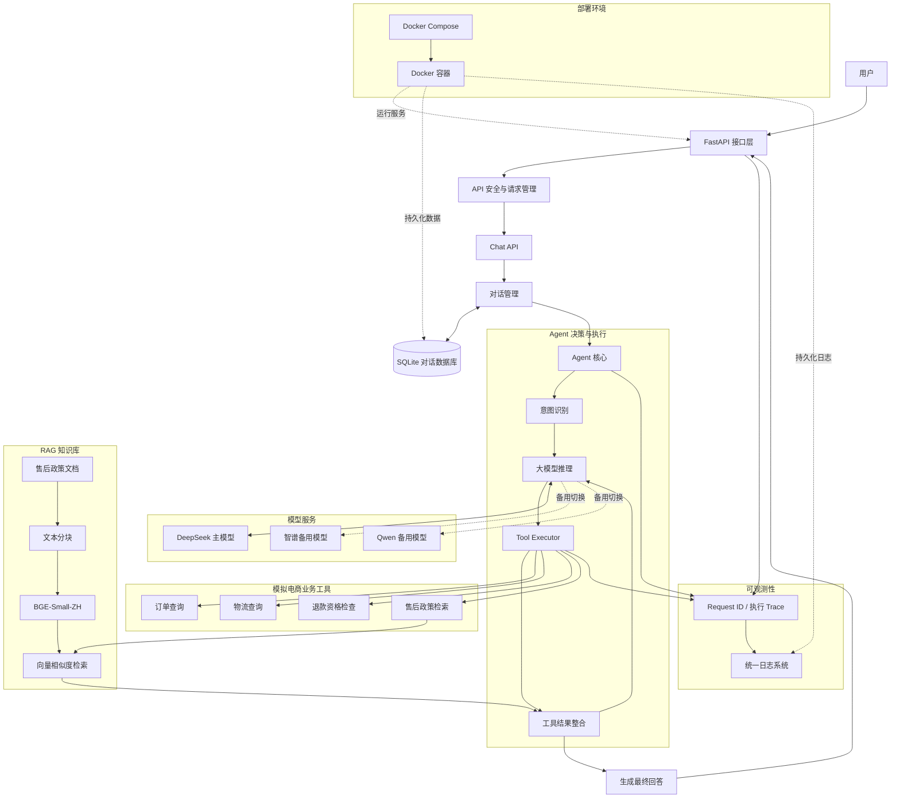

# ShopMate — 智能电商售后 Agent

ShopMate 是一个基于 Python、FastAPI 和大语言模型构建的智能电商售后助手。

项目通过 Agent、Function Calling、RAG 知识库检索等技术，实现订单查询、物流查询、退款资格检查和售后政策问答等功能。

项目重点在于探索大语言模型在实际业务场景中的应用，包括工具调用、知识库检索、多模型备用、对话持久化、请求追踪和 Docker 部署。

## 一、项目功能

### 1. 智能 Agent

- 基于大语言模型理解用户意图。
- 支持多轮对话。
- 根据用户需求选择合适的业务工具。
- 通过 Function Calling / Tool Calling 执行业务操作。
- 整合工具执行结果，生成自然语言回答。

### 2. 电商售后业务工具

| 工具 | 功能 |
|---|---|
| get_order | 查询订单信息 |
| get_logistics | 查询物流信息 |
| check_refund_eligibility | 检查退款资格 |
| search_after_sales_policy | 检索售后政策 |

### 3. RAG 知识库

- 使用 BGE-Small-ZH 模型生成文本向量。
- 对售后政策文档进行分块处理。
- 使用 NumPy 计算余弦相似度。
- 支持 Top-K 检索。
- 设置相似度阈值，过滤低相关度结果。
- 在回答中提供知识库来源信息。

当前使用的 Embedding 模型：

`bge-small-zh-v1.5`

### 4. 多模型备用机制

- DeepSeek 作为主要模型。
- 智谱和 Qwen 作为备用模型。
- 支持模型调用异常时切换备用模型。

### 5. API 服务

基于 FastAPI 提供 HTTP 接口：

| 请求方式 | 接口 | 功能 |
|---|---|---|
| GET | /orders/{order_id} | 查询订单 |
| GET | /logistics/{order_id} | 查询物流 |
| POST | /refunds/check | 检查退款资格 |
| POST | /after-sales | 售后业务接口 |
| GET | /after-sales/{ticket_id} | 查询售后记录 |
| POST | /chat | Agent 对话 |
| GET | /conversations/{conversation_id} | 查询对话记录 |
| DELETE | /conversations/{conversation_id} | 删除对话记录 |
| GET | /traces/{request_id} | 查询请求执行轨迹 |

### 6. 工程化能力

- SQLite 对话持久化。
- 请求 ID 和执行轨迹追踪。
- 统一日志管理。
- 日志文件轮转。
- API Key 身份校验。
- API 请求频率限制。
- 安全响应头。
- Docker 容器化部署。
- Docker Compose 服务管理。
- 容器异常自动重启。

## 二、技术栈

| 技术 | 用途 |
|---|---|
| Python 3.12 | 核心开发语言 |
| FastAPI | 后端 API 框架 |
| 大语言模型 API | 意图识别与 Agent 推理 |
| Function Calling | 业务工具调用 |
| Sentence Transformers | 文本向量化 |
| BGE-Small-ZH | 中文 Embedding 模型 |
| NumPy | 向量相似度计算 |
| SQLite | 对话数据持久化 |
| Pytest | 自动化测试 |
| Docker | 容器化部署 |
| Docker Compose | 容器编排 |

## 三、项目结构

```text
shopmate-agent/
│
├── app/
│   ├── agent/              # Agent 核心逻辑
│   ├── api/                # API 接口
│   ├── core/               # 配置、日志、安全、模型客户端等
│   ├── models/             # 数据模型
│   ├── rag/                # RAG 知识库检索
│   ├── schemas/             # 请求和响应结构
│   └── services/           # 业务服务
│
├── data/
│   └── knowledge/          # 售后知识库文档
│
├── models/
│   └── bge-small-zh-v1.5/   # 本地 Embedding 模型
│
├── logs/                   # 应用日志
├── tests/                  # 自动化测试
│
├── main.py                 # FastAPI 启动入口
├── requirements.txt        # Python 依赖
├── Dockerfile              # Docker 镜像配置
├── docker-compose.yml      # Docker Compose 配置
├── .dockerignore           # Docker 构建忽略文件
├── .env                    # 环境变量（不提交）
└── README.md
```

## 四、本地运行

### 1. 克隆项目

```bash
git clone <你的GitHub仓库地址>
cd shopmate-agent
```

### 2. 创建虚拟环境

```bash
python -m venv .venv
```

Windows PowerShell：

```powershell
.\.venv\Scripts\Activate.ps1
```

### 3. 安装依赖

```bash
python -m pip install -r requirements.txt
```

### 4. 配置环境变量

在项目根目录创建 `.env` 文件，按照项目实际配置填写模型 API：

```env
DEEPSEEK_API_KEY=你的DeepSeek_API_Key
ZHIPU_API_KEY=你的智谱_API_Key
QWEN_API_KEY=你的Qwen_API_Key
```

其余模型配置按照项目实际配置填写。

注意：`.env` 文件包含敏感信息，不应上传到公开代码仓库。

### 5. 启动服务

```bash
uvicorn main:app --reload
```

访问 API 文档：

```text
http://127.0.0.1:8000/docs
```

## 五、Docker 部署

项目支持 Docker Compose 部署。

### 1. 构建镜像

```bash
docker compose build
```

### 2. 启动服务

```bash
docker compose up -d
```

### 3. 查看容器状态

```bash
docker compose ps
```

### 4. 查看运行日志

```bash
docker compose logs -f shopmate
```

### 5. 停止服务

```bash
docker compose stop
```

### 6. 重启服务

```bash
docker compose restart
```

项目通过 Docker Volume 持久化数据库、模型和日志目录。容器应用进程异常退出时，支持自动重启。

## 六、系统架构

ShopMate 采用分层架构，将 API 接入、Agent 决策、模型服务、业务工具、RAG 知识库和数据持久化等模块分开。

### 1. 系统架构图



### 2. 核心业务流程

1. 用户通过 FastAPI 接口提交问题。
2. Agent 结合当前对话上下文理解用户需求。
3. Agent 识别用户意图，判断是否需要调用业务工具。
4. 根据业务需求选择订单、物流、退款资格或售后政策工具。
5. RAG 工具从售后知识库中检索相关内容。
6. Agent 整合工具返回结果，生成最终回答。
7. 系统记录对话内容、请求 ID 和执行轨迹。

## 七、项目设计亮点

### 1. Agent 与传统 API 的结合

不是简单地将用户问题发送给大模型，而是通过意图识别和工具调用，让模型根据业务需求选择对应工具，再整合业务结果。

### 2. RAG 知识库增强

将售后政策文档转换为向量，通过相似度检索找到相关内容，降低模型脱离业务规则自由回答的风险。

### 3. 多模型备用机制

在主要模型调用失败时，支持切换备用模型，提高服务可用性。

### 4. 可观测性

通过 Request ID、执行 Trace 和统一日志，记录模型调用、意图识别、工具执行和最终回答等关键环节，方便定位问题。

### 5. 工程化部署

通过 Docker 和 Docker Compose 实现容器化部署，并使用数据卷持久化关键数据。

## 八、测试情况

项目使用 Pytest 进行自动化测试。

执行测试：

```bash
python -m pytest -q
```

当前已完成的自动化测试结果：

**60 passed**

另外完成了以下专项验证：

- Agent 端到端业务测试。
- 意图识别测试。
- 工具选择测试。
- 工具参数测试。
- RAG 检索测试。
- RAG 回答测试。
- Docker 容器 API 测试。
- Docker 容器重启与数据持久化测试。

## 九、项目边界

ShopMate 是一个用于学习和展示 Agent 工程能力的模拟电商售后系统。

当前订单、物流和售后业务基于项目内的模拟数据，不代表真实电商平台数据。

当前系统不直接执行真实退款、不修改真实订单，也不代表已经接入真实客服工单平台。

## 十、后续优化方向

- 引入 Redis 实现分布式限流。
- 优化 RAG 检索效果。
- 增加 Rerank 重排序。
- 引入更完善的 Agent 评估体系。
- 增加生产环境监控。
- 接入真实业务系统和权限体系。

---

## 项目信息

- **项目名称：** ShopMate 智能电商售后 Agent
- **项目类型：** LLM Agent / RAG / FastAPI / Docker
- **开发语言：** Python
- **项目状态：** 核心功能开发完成，已完成 Docker 部署与基础业务验收。